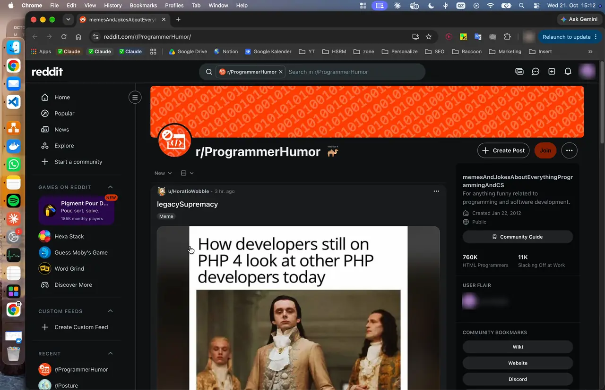
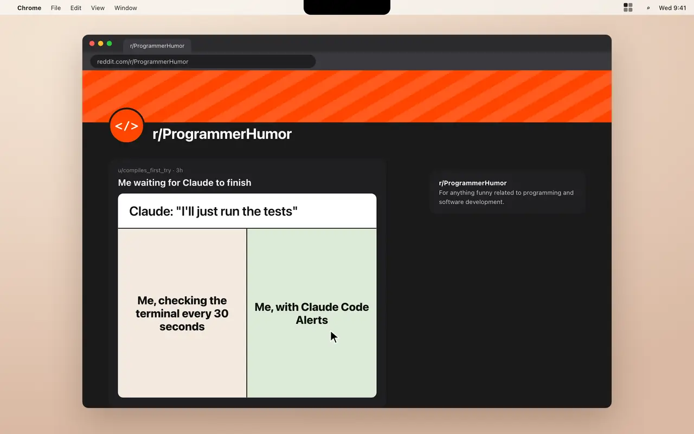
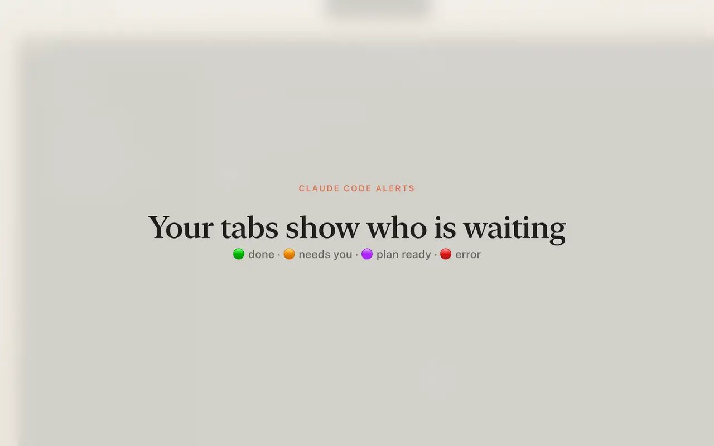
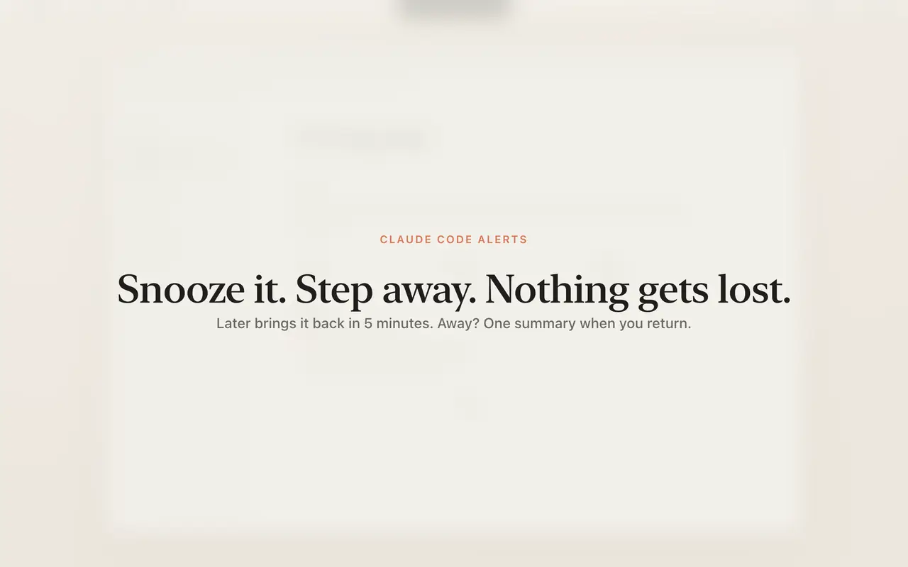
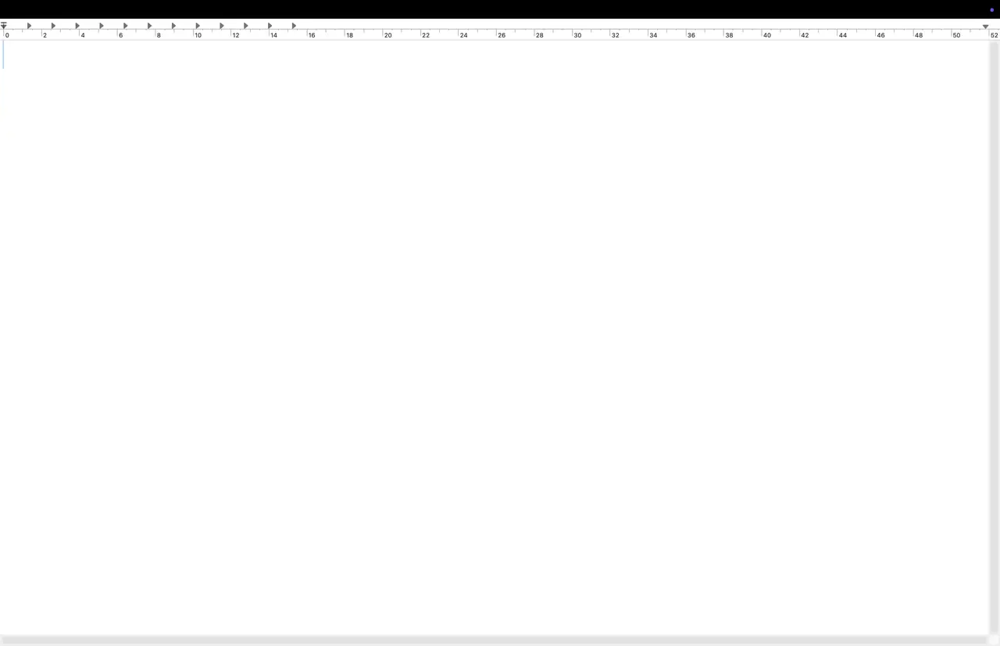
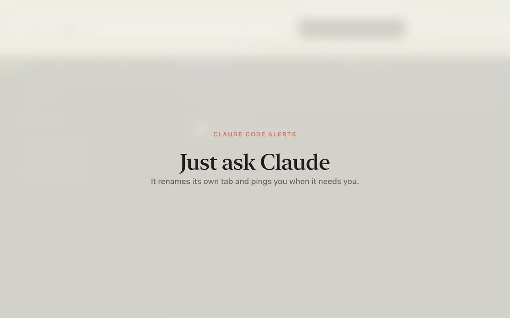

# Claude Code Alerts

**macOS notifications for Claude Code in VS Code.** Know which session is done, needs your permission or has a plan
ready, even while you are on Reddit, and jump straight to its exact VS Code terminal tab with one click.

<p align="center">
  
</p>

```bash
curl -fsSL https://raw.githubusercontent.com/LucaL1fe/claude-code-alerts/main/install.sh | bash
```

One command installs the menu bar app, the Claude Code hooks and skill, and the VS Code extension.
Free and open source (MIT). macOS 14+.

---

## Why

Running four Claude Code sessions in parallel is great until you lose track of them. Claude Code's own notifications
don't reach the VS Code terminal, Focus mode swallows banners, and every tab looks the same. You end up clicking
through tabs to find the one that has been waiting for you for ten minutes.

Claude Code Alerts fixes exactly that:

- **You notice it.** A pill under the notch and a sound, drawn on top of every app and every desktop. It still shows
  when Focus / Do Not Disturb is on.
- **You know who.** The pill says which session and what happened: `checkout-refactor · Validation added, all 3 tests pass`.
- **You land in the right place.** Click the pill and VS Code comes to the front, on the right desktop, with that exact
  terminal tab focused.

## What it looks like

### Several sessions want you at once

The most urgent comes first: orange needs you, purple plan ready, green done. The menu bar icon takes the color of the
most urgent item and shows how many are waiting. Click a row to open it.

<p align="center"></p>

### Your tabs show who is waiting

Each session's terminal tab gets a colored dot: 🟢 done, 🟠 needs you, 🟣 plan ready, 🔴 error. Once you have looked
at it, it goes back to Claude's own title. The **Claude Sessions** view in the Explorer and the status bar show the
same at a glance.

<p align="center"></p>

### Not now? Snooze it. Away? Nothing gets lost

The clock button brings an alert back in 5 minutes (change it in Settings). While you are away (screen locked, display
asleep or idle) alerts wait quietly; when you are back you get one "While you were away" summary with a single sound.

<p align="center"></p>

### Claude is using your Mac

When a session drives your Mac (computer use), a thin red ring stays around the screen so you keep your hands off, and
a short green glow tells you when you can type again. The ring lets every click through. (This is the only glow:
other alerts are just the pill and a sound.)

<p align="center"></p>

### Just ask Claude

The skill teaches Claude the `cca` command: "rename this tab to release-checklist", "if you need my password, notify
me". Claude does it, and the pill shows Claude's own words.

<p align="center"></p>

## Features

| | |
|---|---|
| Pill on every app, every desktop, full screen apps, Focus on | Menu bar icon colored by the most urgent waiting item, with a count |
| Exact VS Code terminal tab, on the right desktop, in one click | Colored dot in each terminal tab title: 🟢 🟠 🟣 🔴 |
| Claude Sessions view and status bar item inside VS Code | Works with several VS Code windows and desktops |
| States: working, needs you, plan ready, done, error, using your Mac | Per pill: quiet ✕, later 🕒, done ✓, go to → |
| No alert when you are already looking at that tab | Snooze time, sound, voice and the Mac ring are separate switches |
| Away detection with one summary when you are back | Rename sessions right in the pill (✎) or by asking Claude |
| Claude can ping you itself: `cca notify --needs-you "…"` | Works with the Claude Code CLI in any terminal; best in VS Code |

## Install

```bash
curl -fsSL https://raw.githubusercontent.com/LucaL1fe/claude-code-alerts/main/install.sh | bash
```

The installer:

1. builds the menu bar app from source (about a minute, needs the Xcode command line tools) or downloads the latest
   release, and puts it in `/Applications`;
2. links the `cca` command to `~/.claude-code-alerts/bin/cca`;
3. adds the hooks to `~/.claude/settings.json` (a backup is saved next to it, your other settings stay untouched) and
   the skill to `~/.claude/skills/claude-code-alerts`;
4. installs the VS Code extension and starts the app.

> **Then reload your open VS Code windows once:** `Cmd+Shift+P` › **Developer: Reload Window**. VS Code only loads a
> newly installed extension after a reload. Your terminals and Claude sessions keep running.

Running sessions pick up the hooks by themselves. Run the same command again to update.

**Uninstall:** `~/.claude-code-alerts/uninstall.sh` removes the app, hooks, skill and extension and keeps the rest of
your settings exactly as they were.

**As a Claude Code plugin:** the hooks and the skill are also available as a plugin
(`/plugin marketplace add LucaL1fe/claude-code-alerts`), but you still need the app from the installer.

## How it works

```
Claude Code session ──hooks──▶ cca ──socket──▶ Claude Code Alerts.app ──▶ glow, pill, menu bar, sound
                                                         │
                                                         └──socket──▶ VS Code extension ──▶ focuses the terminal tab
```

- **Hooks** (`Stop`, `Notification`, `PermissionRequest`, `PreToolUse` for plans, questions and computer use,
  `UserPromptSubmit`, `SessionStart`, `SessionEnd`) call `cca hook`. They run asynchronously and never slow Claude down.
- **`cca`** finds the session's terminal by walking up the process tree (hook → claude → the terminal's shell) and
  reads the session name from the transcript.
- **The app** (Swift, AppKit + SwiftUI) keeps the state, applies the rules (urgency, smart suppress, away, snooze) and
  draws the overlays as non-activating panels on every Space.
- **The VS Code extension** reports which terminals each window has (by shell PID) and focuses one when the app asks.
  Clicking a pill first brings that window forward, so macOS switches to its desktop.
- **Tab dots** are a terminal title (OSC 2) the app writes to the session's terminal; Claude replaces it with its own
  spinner as soon as it works again.

Everything stays on your Mac. No network, no analytics.

## Ask Claude

The installed skill lets Claude use these itself; you can run them too:

```bash
cca notify --needs-you "Enter your Mac password in the keychain prompt"
cca notify --done "Build finished"          # also --plan, --error
cca rename "checkout-fix"                    # pill, list and VS Code tab
cca mac start "Typing a reply in Mail"       # red ring; computer use turns it on automatically
cca mac end                                  # green "Mac is free"
cca status                                   # all sessions and connected VS Code windows
```

## Settings

Click the menu bar icon › Settings: Later button (1 min to 1 h, default 5 min) · fold pills away after a while (default
never) · colored dots in tab titles · sound · voice (says who and what happened, off by default) · red ring when Claude
uses your Mac · when you count as away · open at login.

## FAQ

**Where does "go to" take me?** Always to where the session already runs, never somewhere new:

| Session runs in | Go to |
|---|---|
| a VS Code terminal | the exact terminal tab, in the right window, on the right desktop |
| the Claude Code panel (VS Code extension) | that panel tab (VS Code asks once to allow the link) |
| the Claude desktop app | brings the Claude app forward |
| iTerm, Ghostty, Terminal, … | brings that app forward |
| the background (`claude -p`, scheduled tasks, scripts) | nothing to jump to: listed quietly, a pill only on errors |

**Does it work without VS Code?** Yes. Alerts, the menu bar and `cca` work with Claude Code in any terminal. Only the
exact-tab jump and the Claude Sessions view need VS Code.

**Where is the icon? Can I move it?** It starts next to the system icons on the right. Hold **Cmd** and drag it
anywhere in the menu bar; the position is remembered. If you use a menu bar manager (Ice, Bartender), make sure it is
not in the hidden section.

**Is this made by Anthropic?** No. It is a community project and not affiliated with Anthropic. "Claude" is a
trademark of Anthropic.

## Contributing

Contributions are very welcome. The goal is a small, polished ecosystem around running many Claude Code sessions in
parallel: better terminal support (iTerm2, Ghostty, Warp), approvals from the pill, a phone push when you are away,
themes. See [CONTRIBUTING.md](CONTRIBUTING.md) to get started, and open an issue with ideas.

## Credits

The idea of matching a session's shell PID to a VS Code terminal comes from
[dimokol/claude-notifications](https://github.com/dimokol/claude-notifications) (MIT). Thanks to the notch apps
(Vibe Island, CodeIsland, Vibe Notch) and cmux for showing what good agent status UX looks like.

## License

MIT © LucaL1fe and contributors
